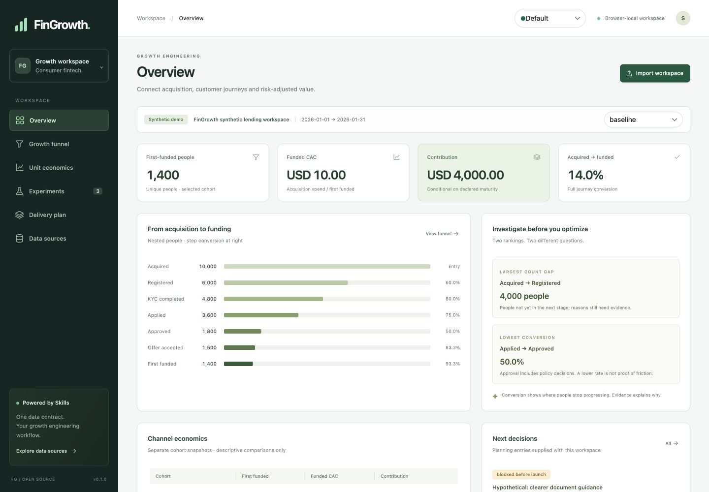

# Growth workspace dashboard

The lightweight Next.js dashboard connects the Skills' outputs in one browser-local workspace: overview, funnel, unit economics, experiments, delivery and source mapping. UI components use HeroUI. The default sage theme is retained alongside Tesla, NVIDIA, AMD, Meta, Google, Amazon and Uber inspired themes. These are application palettes, not official company products or endorsements.

## Run locally

Node.js 20.9+ and npm are needed for the dashboard. Python 3.10+ is used by the adapter/calculator and cross-engine tests.

```sh
cd dashboard
npm ci
npm run dev
```

Open the printed local URL. `npm run build` produces a static export in `dashboard/out`; any static server can serve that directory. No database, account connection or backend credentials are needed. The app initially loads the invented lending workspace.

## Bring a source through a Skill

1. Use `growth-data-adapter` on a synthetic or already authorized aggregate export. Establish cohort, first-loan population, observation window, currency, selected loss basis and source provenance. Read the [data contract](DATA-CONTRACT.md).
2. Produce a reviewed mapping profile and run the bundled mapper. It copies known values, validates the whole workspace and leaves the source unchanged. Missing costs or non-nested populations are blockers; do not fabricate replacements.
3. Use **Import workspace** to choose the resulting JSON file or paste it. Validation completes before the current workspace is replaced. Invalid imports keep the existing workspace and display an error.
4. Inspect the source field mapping, switch cohorts and use the views to diagnose, plan and prepare decisions. Experiment and delivery statuses are supplied planning data, not observed launches or deployments.
5. Export the workspace if you want to retain it. Imported data is held only in tab memory and reload restores the demo. Theme choice alone is saved in browser storage; unavailable storage falls back to Default without blocking use.

The mapper is source-agnostic, not a live connector. An authorized agent can retrieve an approved aggregate through an appropriate tool and map it to this contract; retrieval, aggregation and source permissions remain explicit steps. Database credentials, customer records and uncontrolled query execution are not embedded in the dashboard.

## Measurement behavior

The browser calculates from canonical inputs using bounded integer cents for contribution and descriptive division for rates/CAC. Tests reconcile the demo against the Python analyzer, including independent count/rate leaders. The browser contract limits money to 1e12 per field, two decimal places, counts to safe integers and payloads to 2 MB. See the contract for population and capacity constraints.

Only the selected cohort feeds the headline metrics. Comparison rows remain separate and retain currency; no implicit portfolio total or channel winner is created. Immature contribution and zero-denominator rates remain unknown. Maturity and approved-aggregate status are source declarations; schema validation cannot verify source truth, privacy or loan schedules.

The original synthetic-only Python analyzer remains synthetic-only. The workspace adapter can carry truthfully declared approved aggregates without relabeling or bypassing that analyzer.

## Acceptance and release

Run from `dashboard/`:

```sh
npm run typecheck
npm test
npm run build
```

Browser acceptance covers all views, cohort switching, invalid-import recovery, importing an actual Agent-generated workspace, responsive layout and theme switching/persistence. Evidence and limitations are recorded in [the acceptance report](../evals/ACCEPTANCE.md). Release packaging can include the static build with `python3 scripts/build_release.py --include-dashboard --output dist/v0.1.0` from a clean committed repository.

## Preview



[NVIDIA theme](images/dashboard-nvidia.jpg) · [390-pixel layout](images/dashboard-mobile.jpg)
